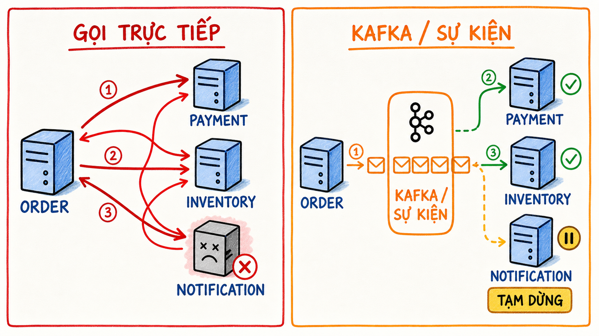

<div align="center">

# Kafka Spring Boot Visual Lab

**Học Apache Kafka bằng cách nhìn, dự đoán, mô phỏng và tự xây lại với Java/Spring Boot.**

[](https://github.com/ngoctri3110/spring-kafka-visual-lab/actions/workflows/validate-course.yml)
[](https://ngoctri3110.github.io/spring-kafka-visual-lab/)
[](LICENSE)

[**Bắt đầu học →**](https://ngoctri3110.github.io/spring-kafka-visual-lab/)

</div>



## Giới thiệu

Kafka Spring Boot Visual Lab là khóa học tương tác bằng tiếng Việt dành cho Java/Spring Boot developer muốn hiểu Kafka từ mental model cơ bản đến các quyết định production.

Thay vì chỉ đọc lý thuyết, mỗi bài kết hợp:

- Sơ đồ trực quan và mô phỏng trạng thái.
- Câu hỏi dự đoán trước khi xem kết quả.
- Failure scenario như rebalance, duplicate, crash, retry và poison event.
- Hướng dẫn thực hành bằng Java, Spring Boot và Spring for Apache Kafka.
- Checklist ghi nhớ cùng tiến độ lưu ngay trên trình duyệt.

Không cần đăng nhập hoặc cài đặt để học. Tiến độ được lưu bằng `localStorage` trên thiết bị hiện tại.

## Lộ trình học

| Giai đoạn | Modules | Nội dung chính |
| --- | --- | --- |
| **Foundation** | 1–3 | Event streaming, topic, partition, offset, consumer group và rebalance |
| **Reliability** | 4–8 | Producer reliability, ordering, schema evolution, commit, retry và DLT |
| **Consistency** | 9–10 | Kafka transactions, exactly-once boundary, transactional outbox và idempotent consumer |
| **Production** | 11–13 | Testing, observability, performance tuning và capstone Order Platform |

Toàn bộ khóa học gồm **12 trang bài học**, **84 điểm kiểm tra** và một capstone cuối khóa.

## Bạn sẽ làm được gì?

Sau lộ trình, người học có thể:

- Giải thích chính xác quan hệ giữa broker, topic, partition, offset và consumer group.
- Chọn message key theo business invariant và đánh giá nguy cơ hot partition.
- Cấu hình producer/consumer theo delivery guarantee mong muốn.
- Phân biệt deserialization failure, transient failure và lỗi nghiệp vụ.
- Thiết kế retry/backoff/DLT có giới hạn, owner và replay policy.
- Giải thích phạm vi thật sự của Kafka exactly-once semantics.
- Kết hợp transactional outbox với idempotent consumer để chịu được duplicate và crash.
- Viết integration test với broker/container thật và theo dõi lag, latency, throughput.

## Cách học hiệu quả

1. **Dự đoán:** trả lời câu hỏi trước khi chạy simulator.
2. **Quan sát:** thay đổi tham số và giải thích vì sao state chuyển đổi.
3. **Tự làm:** viết lại Java/Spring Boot code mà không sao chép từng dòng.
4. **Chứng minh:** chạy test hoặc failure scenario và kiểm tra invariant cuối cùng.

Nếu chưa giải thích được một kết quả bằng lời, hãy chạy lại mô phỏng trước khi chuyển module.

## Chạy cục bộ

Yêu cầu duy nhất là Python 3 hoặc một static HTTP server tương đương:

```bash
git clone https://github.com/ngoctri3110/spring-kafka-visual-lab.git
cd spring-kafka-visual-lab
python -m http.server 8765
```

Mở `http://127.0.0.1:8765/docs/`.

## Cấu trúc repository

```text
.
├── docs/
│   ├── index.html                 # Trang chủ và tiến độ khóa học
│   └── visual-guides/
│       ├── assets/                # Infographic minh họa
│       └── html/                  # 12 module tương tác
├── scripts/
│   └── validate_course.py         # Kiểm tra link, ID và cấu trúc
└── .github/workflows/
    └── validate-course.yml        # Quality gate cho mỗi push/PR
```

## Chất lượng và nguồn tham khảo

Nội dung được đối chiếu với tài liệu công khai, chính thức:

- [Apache Kafka Documentation](https://kafka.apache.org/documentation/)
- [Spring for Apache Kafka Reference](https://docs.spring.io/spring-kafka/reference/)
- [Spring Boot — Apache Kafka Support](https://docs.spring.io/spring-boot/reference/messaging/kafka.html)
- [Debezium Outbox Event Router](https://debezium.io/documentation/reference/stable/transformations/outbox-event-router.html)
- [Testcontainers Kafka Module](https://java.testcontainers.org/modules/kafka/)
- [PostgreSQL Documentation](https://www.postgresql.org/docs/current/)

Kiểm tra repository trước khi gửi thay đổi:

```bash
python scripts/validate_course.py
```

Validator kiểm tra đủ module, liên kết/fragment nội bộ, ID trùng, điều hướng về trang chủ và quy tắc nguồn public.

## Đóng góp

Issue và pull request đều được chào đón. Một đóng góp tốt nên:

- Tập trung vào một lỗi hoặc một mục tiêu học tập rõ ràng.
- Giữ trải nghiệm responsive và không phụ thuộc framework frontend.
- Dẫn nguồn chính thức cho các khẳng định kỹ thuật có thể thay đổi theo phiên bản.
- Chạy thành công `python scripts/validate_course.py` trước khi mở pull request.

Bạn có thể bắt đầu bằng cách báo lỗi nội dung, đề xuất failure scenario hoặc bổ sung bài thực hành Java/Spring Boot.

## Giấy phép

Phát hành theo [Apache License 2.0](LICENSE). Bạn có thể sử dụng, chỉnh sửa và phân phối lại dự án theo các điều khoản của giấy phép.

Copyright © 2026 [ngoctri3110](https://github.com/ngoctri3110).

> Đây là dự án giáo dục độc lập, không trực thuộc hoặc được bảo trợ bởi Apache Software Foundation hay VMware/Broadcom. Apache Kafka, Spring và các tên sản phẩm liên quan thuộc về chủ sở hữu tương ứng.
